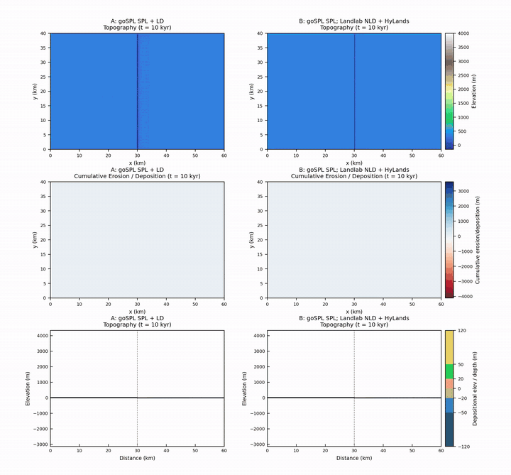

# [goSPL](https://gospl.readthedocs.io/en/stable/index.html#)–[Landlab](https://landlab.readthedocs.io/en/latest/) bridge

[](https://pypi.org/project/gospl-landlab-bridge/) [](https://pepy.tech/project/gospl-landlab-bridge)

v0.0.4

This package is a lightweight add-on that runs [Landlab](https://landlab.readthedocs.io/en/latest/) mountain-erosion components on [goSPL](https://gospl.readthedocs.io/en/stable/index.html#), without changing either code base.

[goSPL](https://gospl.readthedocs.io/en/stable/index.html#) is built for a landscape and its basin to evolve together, but its library of surface processes is still small. [Landlab](https://landlab.readthedocs.io/en/latest/), from the Community Surface Dynamics Modeling System, has a rich set of mountain surface-process models, but it is not set up for basin stratigraphy. The bridge puts those [Landlab](https://landlab.readthedocs.io/en/latest/) components onto [goSPL](https://gospl.readthedocs.io/en/stable/index.html#). [goSPL](https://gospl.readthedocs.io/en/stable/index.html#) still owns the mesh, the time loop, the rivers, sediment routing, tectonics, and the outputs.

The aim is a source-to-sink forward model. Deep-time stratigraphy is the combined result of allogenic change in the source and of accommodation in the sink. The open question is whether the stratigraphy and lithofacies that collect in the sink can record shifts in source-mountain topography and in the geomorphic processes that shape it. Source paleotopography is often gone by the time the rocks are studied, so a forward run is one way to test that.

> [!NOTE]
> This work resulted from an ongoing collaboration with **Dr. Xuesong Ding** at the Bureau of Economic Geology, The University of Texas at Austin.

## Installation

```bash
pip install gospl-landlab-bridge
```

```python
import gospl_landlab_bridge
```

Python cannot import a hyphen, so `gospl-landlab-bridge` is imported as `gospl_landlab_bridge`.

From this repository:

```bash
conda env create -f environment.yml
conda activate gospl-landlab-bridge
pip install -e .
```

## goSPL and Landlab

```bash
pip install landlab
```

Landlab installation: [landlab.readthedocs.io](https://landlab.readthedocs.io/en/latest/installation.html).

goSPL installation: [gospl.readthedocs.io](https://gospl.readthedocs.io/en/v2026.7.14/getting_started/installPip.html).

On a Mac, before `from gospl.model import Model`:

```python
from gospl_landlab_bridge import install_vtk_shim
install_vtk_shim(force=True)
```

## goSPL vs LandLab model comparison

The notebook [`goSPL-LandLab-Bridge_1_compare_SPL_vs_HyLands.ipynb`](goSPL-LandLab-Bridge_1_compare_SPL_vs_HyLands.ipynb) made the clip below. Saved model files under `examples/outputs/` are local only. They are not in the repository.

```bash
python -m gospl_landlab_bridge.mesh_builder
python examples/run_compare.py both
python examples/make_compare_plots.py
```

Below is a comparison of running [goSPL native surface-process models](https://gospl.readthedocs.io/en/stable/user_guide/surfproc.html) (SPL: stream-power fluvial model; LD: hillslope linear diffusion) against running goSPL native SPL mixed with [Landlab’s soil-depth-dependent hillslope nonlinear diffuser](https://landlab.readthedocs.io/en/latest/tutorials/hillslope_geomorphology/depth_dependent_taylor_diffuser/depth_dependent_taylor_diffuser.html) and the [HyLands bedrock landslider](https://landlab.readthedocs.io/en/latest/tutorials/landscape_evolution/hylands/HyLandsTutorial.html).

Both runs share the same allogenic conditions on a 60×40 km domain over 4 Myr. goSPL carries an irregular mesh, so the landscape is not forced into the blocky pattern common on a plain regular grid.

Sediment produced in the source feeds the sink stratigraphy. The landslides are pulsed mass-wasting events. They keep reshaping both the orogen and the deep-water bathymetry in ways the goSPL-only run does not. The same kind of hillslope model is a way to think about deep-water stratigraphy and bathymetry, where turbidity currents and large submarine slides may share some behavior with landslides on land.



Full-resolution video:

https://github.com/user-attachments/assets/fc4a3a02-10cc-48bb-a6fb-de4a25fe8593

The same clip is also in [`docs/media/compare_combo.mp4`](docs/media/compare_combo.mp4).

## Citation

Lai, L.S.-H. (2026) goSPL-LandLab-Bridge.

Contact: larrysyuhenglai@gmail.com

- [goSPL](https://gospl.readthedocs.io/en/stable/index.html#): Salles et al. (2020), JOSS
- [Landlab](https://landlab.readthedocs.io/en/latest/): Hobley et al. (2017); Barnhart et al. (2020)
- SPACE / HyLands: Shobe et al. (2017); Campforts et al. (2020)

## Key Features

- Three slots, `fluvial`, `hillslope`, and `mass_wasting`, each set to `gospl.*` or `landlab.<Component>`.
- Push the [goSPL](https://gospl.readthedocs.io/en/stable/index.html#) mesh to a [Landlab](https://landlab.readthedocs.io/en/latest/) raster and pull Δz and Δsoil back.
- Sediment from that change goes into [goSPL](https://gospl.readthedocs.io/en/stable/index.html#) stratigraphy.
- [Landlab](https://landlab.readthedocs.io/en/latest/) work stays on MPI rank 0.

## Package structure

```
gospl_landlab_bridge/
    config.py runner.py mirror.py flow_adapter.py
    loader.py capability.py sediment.py mpi_io.py
    gospl_patches.py vtk_shim.py landlab_dtype.py
    progress.py threads.py postprocess.py
examples/
docs/media/compare_combo.mp4
tests/test_bridge_unit.py
```

Function list: `FUNCTION_DOCUMENTATION.md`.

## Choosing pieces

| Slot | What it controls | Examples |
|------|------------------|----------|
| `fluvial` | River erosion | `gospl.spl`, `landlab.SpaceLargeScaleEroder` |
| `hillslope` | Creep on slopes | `gospl.linear_diffusion`, `landlab.LinearDiffuser` |
| `mass_wasting` | Landslides | `landlab.BedrockLandslider` |

| Setting | Meaning |
|---------|---------|
| `flow: gospl` | Reuse [goSPL](https://gospl.readthedocs.io/en/stable/index.html#)’s river network |
| `flow: landlab` | [Landlab](https://landlab.readthedocs.io/en/latest/) flow on the raster. Demo Run B does this for the diffuser and the landslider |

Demo Run B keeps rivers on [goSPL](https://gospl.readthedocs.io/en/stable/index.html#) stream power. After that, elevation is pushed to a regular raster. [Landlab](https://landlab.readthedocs.io/en/latest/) diffusion, a D8 flow accumulator, and BedrockLandslider run there. The bridge writes back Δz and Δsoil.

```python
from gospl_landlab_bridge import probe_component
print(probe_component("BedrockLandslider"))
```

`supported` means the bridge expects it to work. `needs_landlab_flow` means set `flow: landlab`.

## Dependencies

Python >= 3.10.

**With the package**

- `numpy` — arrays
- `scipy` — interpolation used when mapping the mesh
- `landlab>=2.6` — [Landlab](https://landlab.readthedocs.io/en/latest/) hillslope, flow, and landslide components
- `joblib` — parallel frame plots
- `imageio>=2.31`, `imageio-ffmpeg` — GIF and MP4 output
- `h5py` — [goSPL](https://gospl.readthedocs.io/en/stable/index.html#) HDF5 output
- `pandas` — tables inside the [goSPL](https://gospl.readthedocs.io/en/stable/index.html#) pit-fill patch
- `matplotlib` — maps and sections
- `tqdm` — progress bars
- `pyyaml` — run settings
- `threadpoolctl` — BLAS thread count
- `pillow` — image frames

**Installed separately**

- [goSPL](https://gospl.readthedocs.io/en/v2026.7.14/getting_started/installPip.html), installed separately
- Optional: `mpi4py`, `petsc4py` when you run [goSPL](https://gospl.readthedocs.io/en/stable/index.html#) with MPI

## Common problems

**[goSPL](https://gospl.readthedocs.io/en/stable/index.html#) import crashes.** Call `install_vtk_shim(force=True)` first.

**PriorityFlood crashes on some Macs.** The demo does not use it. Rivers use [goSPL](https://gospl.readthedocs.io/en/stable/index.html#) stream power. The hillslope and landslide stack uses [Landlab](https://landlab.readthedocs.io/en/latest/) `FlowAccumulator`.

**Output folders named `runA_gospl_spl_0`, `_1`, …** [goSPL](https://gospl.readthedocs.io/en/stable/index.html#) does that when `makedir: True`. The demo files use `makedir: False`.

**Large meshes.** [Landlab](https://landlab.readthedocs.io/en/latest/) runs on MPI rank 0 after the surface is gathered.

## License

goSPL–Landlab bridge is licensed under the GNU Affero General Public License 3.0 or later. See [LICENSE](LICENSE).

[goSPL](https://gospl.readthedocs.io/en/stable/index.html#) is GPL-3.0. [Landlab](https://landlab.readthedocs.io/en/latest/) is MIT. The pit-fill change in `gospl_patches.py` is adapted from [goSPL](https://gospl.readthedocs.io/en/stable/index.html#), and that copyright stays with the [goSPL](https://gospl.readthedocs.io/en/stable/index.html#) authors.

See [CONTRIBUTING.md](CONTRIBUTING.md) for how to report issues, request features, and submit pull requests.
